# Job Board

Site web qui **collecte des offres d'emploi, de stage et d'alternance** et aide les visiteurs à les trouver et à y postuler. Un administrateur gère les offres, les entreprises, les catégories, les personnes et les **candidatures reçues** depuis une interface dédiée.

**Stack** : Flask (pages + API) · SQLite (base de données) · JavaScript natif (front, sans étape de build).

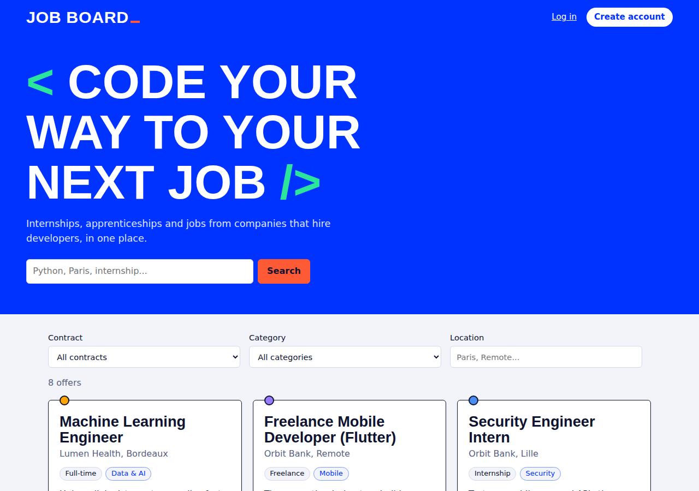

## Sommaire

1. [Architecture](#1-architecture)
2. [Installation pas à pas](#2-installation-pas-à-pas) et [comptes de test](#comptes-de-test)
3. [Les 8 steps : ce qui a été fait, comment, pourquoi, où](#3-les-8-steps)
4. [Base de données](#4-base-de-données) (schéma, justification de chaque champ, `queries.sql`)
5. [API : routes, exemples `curl`, codes de retour](#5-api)
6. [Choix techniques et alternatives écartées](#6-choix-techniques-et-alternatives-écartées)
7. [Tests](#7-tests)
8. [Limites connues](#8-limites-connues)
9. [Captures d'écran](#9-captures-décran)
10. [Usage de l'IA](#10-usage-de-lia)

---

## 1. Architecture

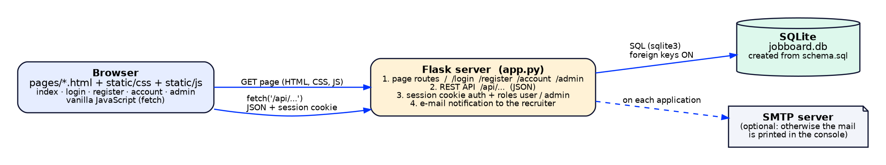

```
Navigateur ──GET /, /login, /admin...──▶  Flask (app.py)  ──SQL──▶  SQLite (jobboard.db)
     │                                       ▲   │
     └──── fetch('/api/...') JSON + cookie ──┘   └──(option) SMTP : e-mail au recruteur
```

- Le **navigateur** reçoit des pages HTML statiques (`pages/`), puis le JavaScript (`static/js/`) appelle l'API en JSON avec `fetch`. Aucune page n'est générée côté serveur : le HTML est le même pour tout le monde, les données arrivent par l'API.
- **Flask** (`app.py`) fait quatre choses : sert les pages, expose l'API REST, gère l'authentification (cookie de session signé) et envoie l'e-mail au recruteur à chaque candidature.
- **SQLite** stocke tout dans un seul fichier. Le schéma est dans `schema.sql`, appliqué automatiquement au démarrage.

### Arborescence

```
app.py            API REST, authentification, routes des pages, migration + création de l'admin au démarrage
schema.sql        schéma de la base (5 tables)
seed.py           remplit la base en appelant l'API (catégories, entreprises, offres, compte de test, candidatures)
queries.sql       step 01 : insertions faites à la main + les 3 requêtes
run_sql.py        exécute un fichier .sql et affiche les SELECT (pratique sous Windows, sans client sqlite3)
pages/            index, login, register, account, admin, 404  (admin n'est servi qu'aux administrateurs)
static/css/       style.css (une seule feuille de style pour toutes les pages)
static/js/        common.js (appel API, navigation) · index.js · auth.js · admin.js
tests/            test_api.py (14 tests automatiques de l'API)
docs/             schémas (architecture.png, database.png), captures d'écran et IA.md (usage de l'IA)
```

---

## 2. Installation pas à pas

Prérequis : **Python 3.10 ou plus récent**.

```bash
# 1. Se placer dans le dossier du projet
cd jobboard

# 2. Créer et activer un environnement virtuel
python -m venv .venv
source .venv/bin/activate          # macOS / Linux
.venv\Scripts\activate             # Windows (cmd ou PowerShell)

# 3. Installer la dépendance (Flask)
pip install -r requirements.txt

# 4. Remplir la base avec des données de démonstration (une seule fois, optionnel mais conseillé)
python seed.py

# 5. Lancer le serveur
python app.py
```

Ouvrir **http://127.0.0.1:5000**.

Au premier lancement, `jobboard.db` est créé automatiquement à partir de `schema.sql` **et le compte administrateur ci-dessous est créé**. `seed.py` passe par l'API (il se connecte en admin) ; il refuse de s'exécuter deux fois (« Database already contains data »).

### Comptes de test

| Rôle | E-mail | Mot de passe | Créé par | Après connexion |
|---|---|---|---|---|
| Administrateur | `admin@jobboard.local` | `admin1234` | `python app.py` (automatique) | redirigé vers `/admin` |
| Utilisateur | `user@jobboard.local` | `user12345` | `python seed.py` | redirigé vers la page des offres `/` |

Ces deux comptes fonctionnent sur une installation neuve (vérifié, voir [Tests](#7-tests)). On peut aussi créer un compte sur `/register`.

### Variables d'environnement (toutes optionnelles)

| Variable | Défaut | Rôle |
|---|---|---|
| `ADMIN_EMAIL` / `ADMIN_PASSWORD` | `admin@jobboard.local` / `admin1234` | compte admin créé au démarrage. Le mot de passe doit faire **8 caractères minimum**, sinon le serveur refuse de démarrer |
| `SECRET_KEY` | `dev-only-change-me` | clé de signature des cookies de session (à changer hors développement) |
| `DB_PATH` | `./jobboard.db` | emplacement de la base |
| `PORT` | `5000` | port du serveur |
| `SMTP_HOST`, `SMTP_PORT`, `SMTP_USER`, `SMTP_PASSWORD`, `MAIL_FROM` | (vide) | vrais e-mails. Sans `SMTP_HOST`, l'e-mail est **affiché dans la console** du serveur |

### Dépannage

- **« Le compte admin est refusé »** : une base `jobboard.db` créée avec une ancienne version peut contenir un autre admin. Au démarrage, l'application crée `ADMIN_EMAIL` s'il n'existe pas ; s'il existe déjà avec un autre mot de passe, **il le garde**. Le plus simple : supprimer `jobboard.db`, relancer `python app.py` puis `python seed.py`.
- **Base d'une version précédente (sans catégories)** : la colonne `category_id` est ajoutée automatiquement, mais SQLite ne permet pas d'ajouter une colonne `NOT NULL` à une table existante : les anciennes offres resteraient sans catégorie. Le plus simple : supprimer `jobboard.db`, relancer `python app.py` puis `python seed.py`.
- **Page sans style** : vérifier que l'URL est `http://127.0.0.1:5000/...` (le CSS est chargé depuis `/static/css/style.css`).
- **Démo des requêtes SQL** : `python run_sql.py queries.sql demo.db` (utilise une base jetable `demo.db`, jamais la vraie).

---

## 3. Les 8 steps

### Step 01 — Base de données

- **Ce qui a été fait** : le schéma SQLite avec 5 tables (`companies`, `people`, `categories`, `advertisements`, `applications`), clés étrangères, contraintes `UNIQUE` / `CHECK`, index. Un fichier `queries.sql` contient les **insertions faites à la main** et les **3 requêtes** (nombre d'annonces par entreprise ; annonce la plus demandée ; candidats d'une annonce).
- **Comment** : `schema.sql` est exécuté à chaque démarrage (`CREATE TABLE IF NOT EXISTS`, donc sans effet sur une base existante). `PRAGMA foreign_keys = ON` est activé à chaque connexion, car SQLite ne vérifie pas les clés étrangères par défaut. Une petite migration ajoute `category_id` aux bases créées avant l'arrivée des catégories.
- **Pourquoi** : une seule table `people` pour les recruteurs, les candidats et les comptes évite de dupliquer une personne qui est à la fois contact d'une offre et candidate ; `password_hash` vide = personne sans compte (invité). La table `categories` permet de filtrer proprement au lieu d'un texte libre.
- **Où** : `schema.sql`, `queries.sql`, `run_sql.py`, migration dans `init_db()` d'`app.py`. Détail des champs : [section 4](#4-base-de-données).

### Step 02 — Page des annonces

- **Ce qui a été fait** : la page d'accueil liste les offres (6 par page) avec titre, entreprise, lieu, type de contrat, catégorie, description courte et bouton « Learn more ».
- **Comment** : `pages/index.html` contient la structure, `static/js/index.js` appelle `GET /api/advertisements` et fabrique les cartes. Pagination « Previous / Next » côté serveur.
- **Pourquoi** : charger par page évite de transférer toute la table ; les cartes sont générées en JavaScript pour que la recherche et les filtres rafraîchissent la liste sans recharger la page.
- **Où** : `pages/index.html`, `static/js/index.js` (`load()`, `card()`).

### Step 03 — « Learn more »

- **Ce qui a été fait** : le clic déroule les détails **dans la carte** (sans rechargement ni pop-up) : contrat, catégorie, lieu, temps de travail, salaire, date, contact, description complète, entreprise avec lien vers son site.
- **Comment** : `GET /api/advertisements/<id>` est appelé au premier clic, le résultat est mis en cache dans le panneau (`data-ready`) ; le bouton devient « Show less » (`aria-expanded` mis à jour pour l'accessibilité).
- **Pourquoi** : la liste reste légère (descriptions courtes uniquement) et les champs affichés portent exactement les noms des colonnes de la base.
- **Où** : `static/js/index.js` (`details()`, gestionnaire de clic).

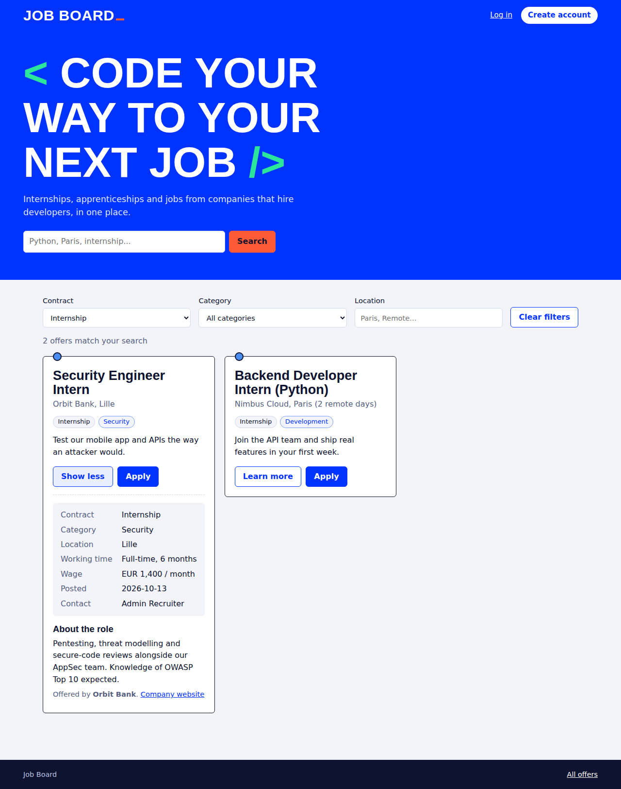

### Step 04 — API

- **Ce qui a été fait** : API REST JSON complète (verbes HTTP et codes de retour corrects) pour les 5 ressources, avec pagination, recherche et filtres. `seed.py` remplit la base **en appelant cette API**, ce qui la teste en conditions réelles.
- **Comment** : un dictionnaire `TABLES` décrit chaque ressource (colonnes modifiables, champs obligatoires, jointures, filtres, qui peut lire) et cinq fonctions génériques (liste, détail, création, modification, suppression) les servent toutes. Les erreurs SQL (doublon, clé étrangère inconnue, valeur interdite) sont converties en 409 / 400 avec un message lisible.
- **Pourquoi** : ajouter une table (ce qui a été fait pour `categories`) = ajouter une entrée au dictionnaire, pas écrire cinq routes de plus ; le comportement reste identique partout.
- **Où** : `app.py` (`TABLES`, `paginated()`, `create_row()`…, `company_ads()`), `seed.py`. Toutes les routes : [section 5](#5-api).

### Step 05 — Postuler

- **Ce qui a été fait** : le bouton « Apply » ouvre un formulaire dans la carte. Un invité saisit prénom, nom, e-mail, téléphone (optionnel) et message ; l'envoi crée la candidature, enregistre l'invité dans `people` et **envoie un e-mail au contact de l'offre**. Retours clairs : « Application sent », « You already applied », erreurs de saisie.
- **Comment** : `POST /api/advertisements/<id>/applications`. Si l'e-mail existe déjà dans `people`, la personne est réutilisée. `UNIQUE (advertisement_id, person_id)` + vérification préalable donnent un **409** en cas de double candidature. `email_sent` mémorise si l'envoi a réussi.
- **Pourquoi** : ne pas obliger à créer un compte pour postuler abaisse la barrière ; la contrainte `UNIQUE` en base garantit l'unicité même si deux requêtes arrivent en même temps.
- **Où** : `app.py` (`apply()`, `notify()`), `static/js/index.js` (`applyForm()`, gestionnaire `submit`).

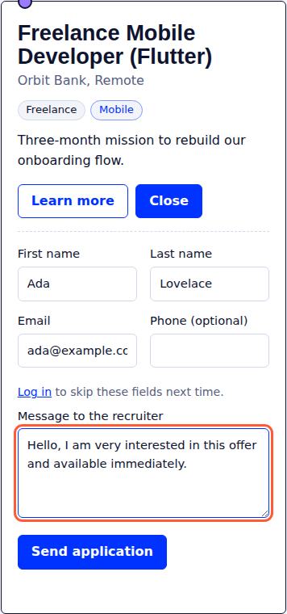 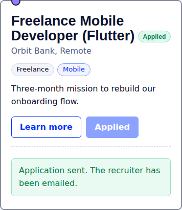

### Step 06 — Authentification

- **Ce qui a été fait** : pages `/register`, `/login`, `/account`. Un utilisateur connecté postule avec un simple message ; il retrouve **ses candidatures et leur statut** sur `/account`, et les offres déjà envoyées sont marquées « Applied ». S'inscrire avec l'e-mail d'une ancienne candidature d'invité rattache le compte à cette personne.
- **Comment** : mots de passe hachés avec `werkzeug.security` (scrypt) ; session = cookie signé `HttpOnly` + `SameSite=Lax`. `GET /api/auth/me/applications` alimente la liste.
- **Pourquoi** : une session par cookie est la solution la plus simple et la plus sûre pour un site dont le front est servi par le même serveur (voir [section 6](#6-choix-techniques-et-alternatives-écartées)).
- **Où** : `app.py` (section « authentication »), `pages/login.html`, `register.html`, `account.html`, `static/js/auth.js`, `common.js` (`loadNav()`).

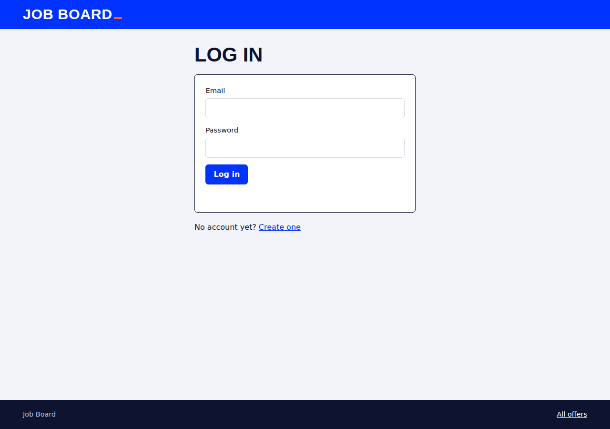 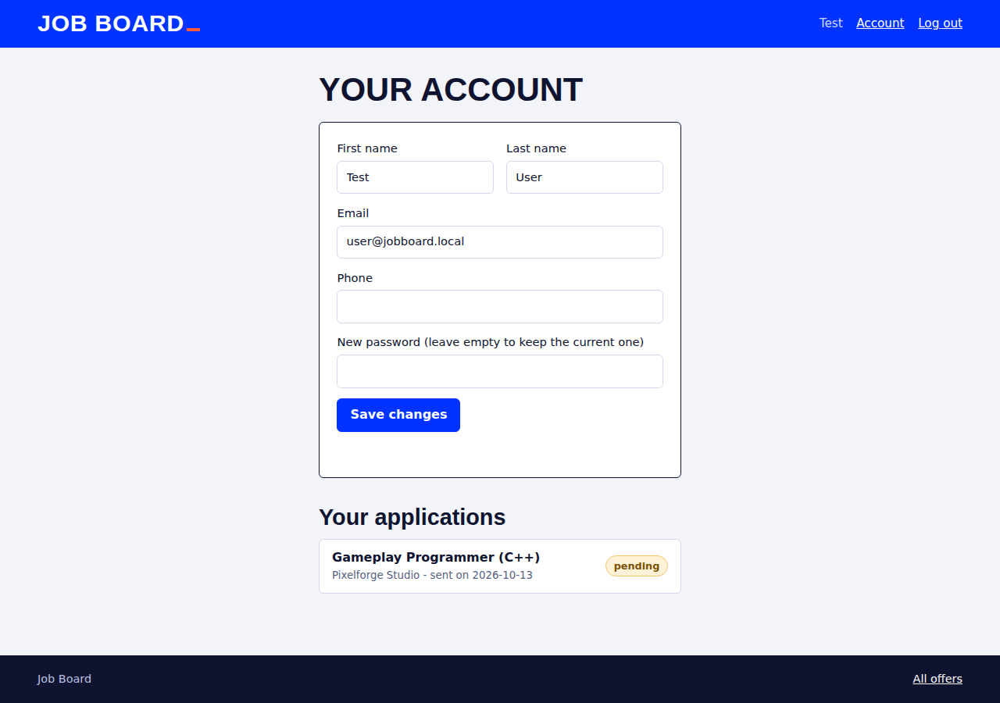

### Step 07 — Administration

- **Ce qui a été fait** : `/admin`, réservé aux administrateurs, avec un onglet par table (offres, entreprises, catégories, personnes, candidatures) : recherche, pagination, création, modification, suppression. Pour les **candidatures** : message visible dans le tableau et **vue détail lisible au clic**, **filtre par annonce et par statut**, **changement de statut en un clic** (liste déroulante dans le tableau, ou boutons `pending / reviewed / accepted / rejected` dans la vue détail). Les formulaires utilisent des **listes déroulantes** (entreprise, contact, catégorie, annonce, personne) au lieu de numéros tapés à la main. Le bouton « Applications » d'une offre ouvre directement ses candidatures.
- **Comment** : la page est servie par Flask seulement si la session est celle d'un admin (sinon redirection vers `/login`, en-tête `Cache-Control: no-store`), et **chaque route d'écriture de l'API vérifie le rôle** (401 si non connecté, 403 si simple utilisateur). Connexion : un admin arrive sur `/admin`, un utilisateur sur `/`, la déconnexion renvoie à `/`.
- **Pourquoi** : protéger la page ne suffit pas, c'est l'API qui doit refuser ; la page cachée est un confort, pas la sécurité.
- **Où** : `pages/admin.html`, `static/js/admin.js` (`TABLES`, `REFS`, `openEditor()`, `renderDetail()`, `setStatus()`), `app.py` (`admin_only()`, `page_admin()`).

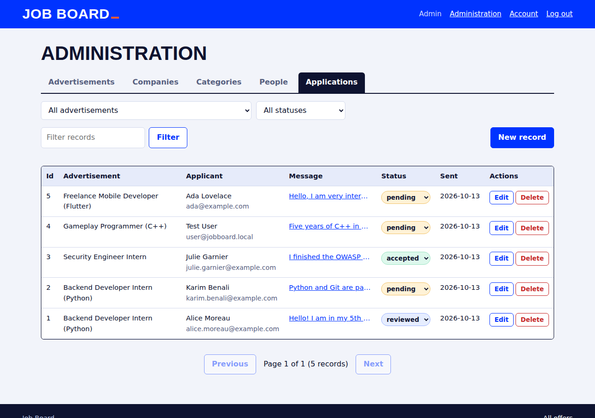
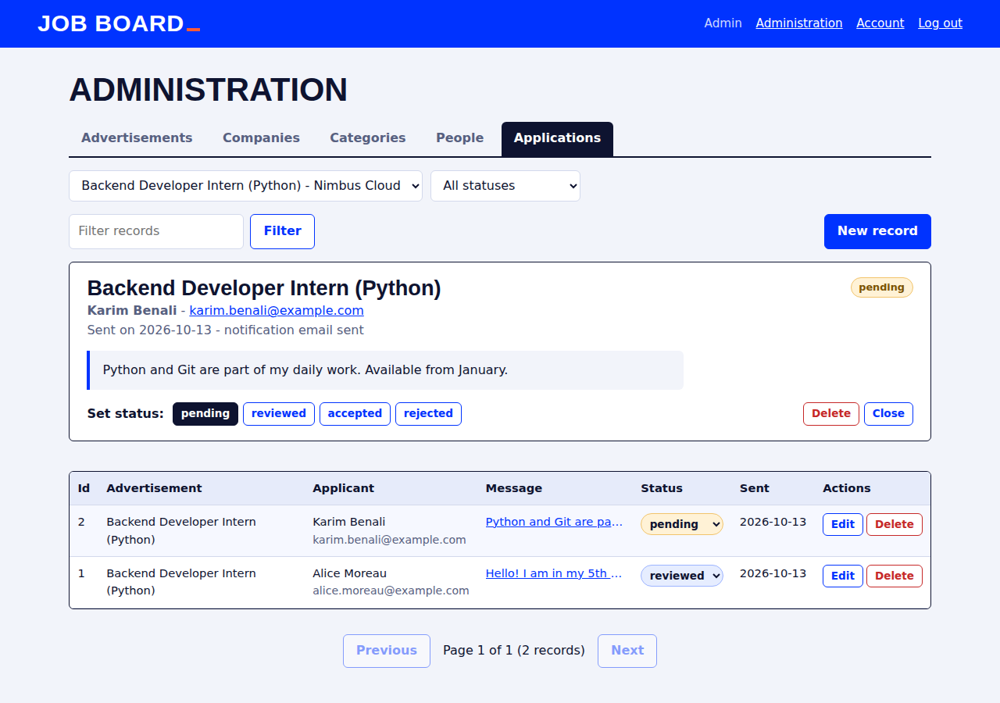
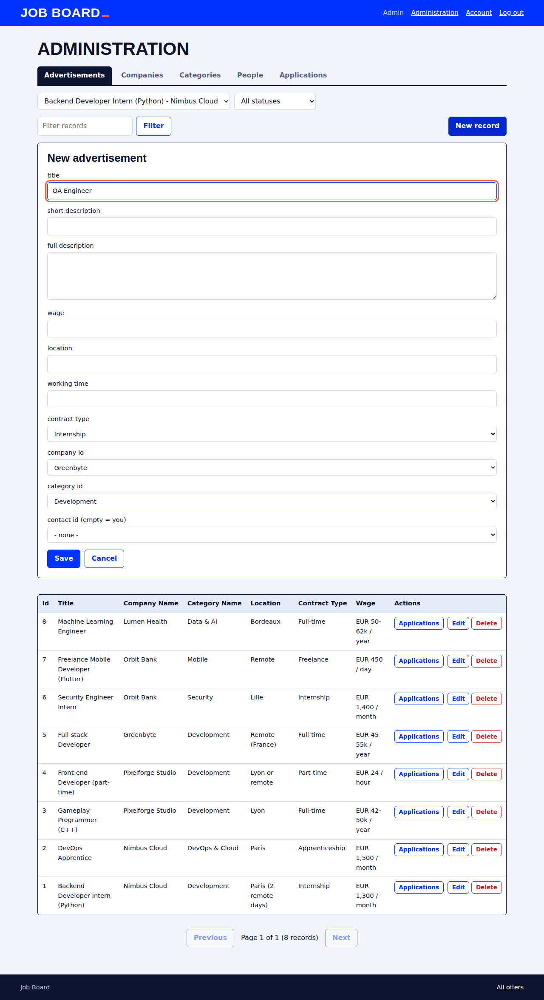

### Step 08 — Finitions (« Polish your pages »)

- **Ce qui a été fait** :
  - liens CSS corrigés en `/static/css/style.css` sur toutes les pages (4 pages utilisaient `static\css\style.css`, qui ne marche qu'avec certains serveurs Windows) ;
  - page des offres : **filtres** type de contrat, catégorie, lieu (en plus de la recherche), compteur de résultats, bouton « Clear filters », détail mieux présenté ;
  - retours utilisateur : squelettes de **chargement**, **liste vide** avec action, **erreur** avec bouton « Try again », message réseau lisible, « Application sent », « Applied » / « You already applied » ;
  - apparence cohérente : même en-tête, pied de page, boutons, badges de statut et couleurs sur toutes les pages, page 404 aux mêmes couleurs ;
  - responsive : testé à 375 px de large (téléphone), tableaux d'admin qui défilent dans leur cadre, formulaires empilés ; focus clavier visible ; animations coupées si `prefers-reduced-motion`.
- **Comment** : une seule feuille de style avec des variables CSS (palette bleu / orange / menthe) ; aucun framework.
- **Pourquoi** : l'interface doit dire à l'utilisateur ce qui se passe à chaque instant (attente, vide, échec, succès).
- **Où** : `static/css/style.css`, `pages/*.html`, `static/js/index.js`, `auth.js`, `admin.js`.

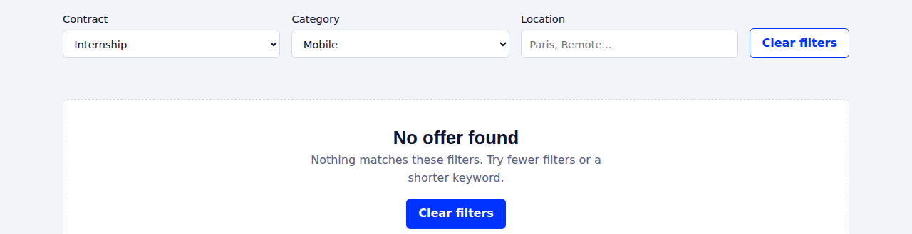

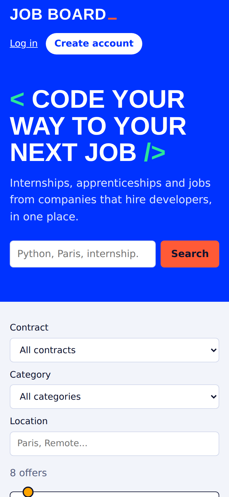 

---

## 4. Base de données

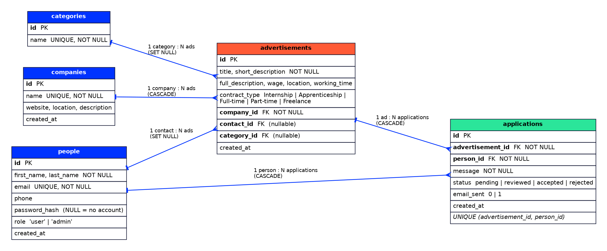

Relations : une entreprise a plusieurs offres ; une offre a **exactement une** catégorie (obligatoire), un contact (une personne, facultatif) et reçoit plusieurs candidatures ; une personne peut déposer plusieurs candidatures, **une seule par offre**.

### Justification des champs

**`companies`** — qui propose les offres.

| Champ | Pourquoi |
|---|---|
| `id` | clé primaire auto-incrémentée, référencée par `advertisements` |
| `name` (UNIQUE, NOT NULL) | une entreprise est identifiée par son nom ; l'unicité évite les doublons |
| `website`, `location`, `description` | informations d'affichage, facultatives |
| `created_at` | date de création (valeur par défaut = maintenant) |

**`categories`** — domaine d'une offre (Development, Data & AI, Security…).

| Champ | Pourquoi |
|---|---|
| `id` | clé primaire |
| `name` (UNIQUE, NOT NULL) | libellé affiché dans le filtre ; unique pour ne pas avoir deux fois « Security » |

**`people`** — recruteurs, candidats et comptes du site.

| Champ | Pourquoi |
|---|---|
| `id` | clé primaire |
| `first_name`, `last_name` (NOT NULL) | nécessaires pour contacter / afficher la personne |
| `email` (UNIQUE, NOT NULL) | identifiant de connexion et clé de rapprochement d'un invité avec un compte (stocké en minuscules) |
| `phone` | facultatif |
| `password_hash` | **hash** scrypt, jamais le mot de passe. `NULL` = personne sans compte (invité, recruteur) |
| `role` (`user` / `admin`, CHECK) | droits ; la contrainte empêche toute autre valeur |
| `created_at` | traçabilité |

**`advertisements`** — les offres.

| Champ | Pourquoi |
|---|---|
| `id` | clé primaire |
| `title`, `short_description` (NOT NULL) | affichés dans la liste ; obligatoires pour qu'une carte soit lisible |
| `full_description` | texte long affiché au « Learn more » |
| `wage`, `working_time` (texte) | formats trop variés pour un nombre (« EUR 42-50k / year », « 21h / week ») ; voir [limites](#8-limites-connues) |
| `location` | filtre par lieu |
| `contract_type` (CHECK) | liste fermée : Internship, Apprenticeship, Full-time, Part-time, Freelance ; sert de filtre et de couleur |
| `company_id` (FK, NOT NULL, `ON DELETE CASCADE`) | une offre appartient forcément à une entreprise ; si l'entreprise disparaît, ses offres aussi |
| `contact_id` (FK, `ON DELETE SET NULL`) | personne responsable de l'offre, destinataire de l'e-mail ; si elle est supprimée, l'offre reste |
| `category_id` (FK, `NOT NULL`, `ON DELETE RESTRICT`) | exactement une catégorie par offre ; une catégorie encore utilisée ne peut pas être supprimée (409), il faut d'abord changer la catégorie de ses offres |
| `created_at` | date de publication |

**`applications`** — candidatures.

| Champ | Pourquoi |
|---|---|
| `id` | clé primaire |
| `advertisement_id` (FK, NOT NULL, CASCADE) | l'offre visée ; supprimée avec l'offre |
| `person_id` (FK, NOT NULL, CASCADE) | le candidat |
| `message` (NOT NULL) | message au recruteur, affiché dans l'admin |
| `status` (CHECK) | `pending` → `reviewed` → `accepted` / `rejected` ; valeur par défaut `pending` |
| `email_sent` (0/1) | permet de savoir si le recruteur a bien été prévenu |
| `created_at` | date de candidature |
| `UNIQUE (advertisement_id, person_id)` | une personne ne postule qu'une fois à une offre (garanti par la base) |

Index : `advertisements(company_id)`, `advertisements(category_id)`, `applications(advertisement_id)`, `applications(person_id)` pour accélérer les jointures et les filtres.

### `queries.sql` : insertions à la main et 3 requêtes

```bash
python run_sql.py queries.sql demo.db     # base jetable, jamais jobboard.db
# ou, avec le client sqlite3 :  sqlite3 demo.db < schema.sql && sqlite3 -header -column demo.db < queries.sql
```

1. **Nombre d'annonces par entreprise** : `LEFT JOIN` + `GROUP BY` + `COUNT(a.id)`. Le `LEFT JOIN` garde les entreprises sans annonce (« Pixel Forge » affiche 0), et `COUNT(a.id)` ne compte pas les `NULL`.
2. **Annonce la plus demandée** : `GROUP BY` sur l'annonce + `ORDER BY COUNT(*) DESC LIMIT 1`.
3. **Candidats d'une annonce** : `JOIN` entre `applications` et `people`, filtré par `WHERE ap.advertisement_id = 1`.

---

## 5. API

Corps et réponses en JSON. Les erreurs ont toujours la forme `{"error": "message"}`. Les listes renvoient `{items, total, page, per_page, pages}` (`?page=` et `?per_page=`, 100 maximum).

`<table>` = `companies`, `categories`, `people`, `advertisements` ou `applications`.

| Route | Accès | Rôle | Codes |
|---|---|---|---|
| `GET /api/advertisements` | public | liste. Filtres : `q`, `contract_type`, `location`, `category_id`, `company_id` (combinables) | 200 |
| `GET /api/advertisements/<id>` | public | détail (avec `company_name`, `category_name`, `contact_name`) | 200, 404 |
| `GET /api/companies`, `GET /api/companies/<id>` | public | entreprises | 200, 404 |
| `GET /api/companies/<id>/ads` | public | offres d'une entreprise (mêmes filtres que la liste des offres) | 200, 404 |
| `GET /api/categories`, `GET /api/categories/<id>` | public | catégories (avec `ads_count`) | 200, 404 |
| `POST /api/advertisements/<id>/applications` | public | postuler (invité : prénom, nom, e-mail, message ; connecté : message) | 201, 400, 404, 409 |
| `POST /api/auth/register` | public | créer un compte (mot de passe ≥ 8 caractères) | 201, 400, 409 |
| `POST /api/auth/login` | public | se connecter (cookie de session) | 200, 401 |
| `POST /api/auth/logout` | public | se déconnecter | 204 |
| `GET /api/auth/me` | connecté | profil | 200, 401 |
| `PUT /api/auth/me` | connecté | modifier son profil / mot de passe | 200, 400, 401, 409 |
| `GET /api/auth/me/applications` | connecté | mes candidatures et leur statut | 200, 401 |
| `GET /api/people`, `GET /api/applications` (+ `/<id>`) | admin | lecture. `applications` : filtres `advertisement_id`, `status`, `person_id`, `q` | 200, 401, 403, 404 |
| `POST /api/<table>` | admin | création (en-tête `Location` renvoyé) | 201, 400, 401, 403, 409 |
| `PUT` ou `PATCH /api/<table>/<id>` | admin | modification (champs partiels acceptés) | 200, 400, 401, 403, 404, 409 |
| `DELETE /api/<table>/<id>` | admin | suppression | 204, 400, 401, 403, 404 |

Signification : **400** données invalides (champ manquant, valeur interdite, référence inconnue) · **401** non connecté · **403** connecté mais pas admin · **404** introuvable · **409** doublon (e-mail déjà inscrit, déjà postulé, nom déjà pris).

Pages : `GET /`, `/login`, `/register`, `/account` (publiques), `/admin` (**302 vers `/login`** si on n'est pas admin), toute autre adresse → page 404.

### Exemples `curl`

Testés sur une base fraîche (`python seed.py`). Les commandes sont écrites pour bash / Git Bash / macOS / Linux (sous PowerShell, utiliser `curl.exe` et échapper les guillemets du JSON). `-c fichier` enregistre le cookie de session, `-b fichier` le renvoie.

```bash
BASE=http://127.0.0.1:5000

# --- Public ---------------------------------------------------------------
curl "$BASE/api/advertisements?per_page=2"                                 # 200  {"items":[...],"total":8,"page":1,"per_page":2,"pages":4}
curl "$BASE/api/advertisements?contract_type=Internship&location=Paris"    # 200  filtres combinés
curl "$BASE/api/advertisements/1"                                          # 200  une offre
curl "$BASE/api/advertisements/999"                                        # 404  {"error":"Not found."}
curl "$BASE/api/companies/1"                                               # 200
curl "$BASE/api/companies/1/ads"                                           # 200  offres de l'entreprise 1
curl "$BASE/api/companies/999/ads"                                         # 404  {"error":"Company not found."}
curl "$BASE/api/categories"                                                # 200  {"items":[{"ads_count":4,"id":1,"name":"Development"},...],...}

# Postuler en invité
curl -X POST $BASE/api/advertisements/3/applications -H "Content-Type: application/json" \
  -d '{"first_name":"Ada","last_name":"Lovelace","email":"ada@example.com","message":"Hello"}'   # 201 {"email_sent":1,"id":5}
# ... la même commande une 2e fois                                         # 409 {"error":"You already applied to this offer."}
curl -X POST $BASE/api/advertisements/3/applications -H "Content-Type: application/json" \
  -d '{"message":"Hello"}'                                                 # 400 First name, last name and a valid email are required.

# --- Authentification -------------------------------------------------------
curl -X POST $BASE/api/auth/register -c user.txt -H "Content-Type: application/json" \
  -d '{"first_name":"Grace","last_name":"Hopper","email":"grace@example.com","password":"password1"}'   # 201 (409 si l'e-mail existe déjà)
curl -X POST $BASE/api/auth/login -c user.txt -H "Content-Type: application/json" \
  -d '{"email":"user@jobboard.local","password":"user12345"}'              # 200   (mauvais mot de passe : 401 Wrong email or password.)
curl -b user.txt $BASE/api/auth/me                                         # 200   (sans cookie : 401 Not logged in.)
curl -b user.txt $BASE/api/auth/me/applications                            # 200   {"items":[{"ad_title":"Gameplay Programmer (C++)","status":"pending",...}]}
curl -X PUT $BASE/api/auth/me -b user.txt -H "Content-Type: application/json" \
  -d '{"phone":"06 12 34 56 78"}'                                          # 200
curl -b user.txt $BASE/api/applications                                    # 403  {"error":"Administrators only."}
curl -X POST $BASE/api/auth/logout -b user.txt                             # 204

# --- Administrateur -------------------------------------------------------------
curl -X POST $BASE/api/auth/login -c admin.txt -H "Content-Type: application/json" \
  -d '{"email":"admin@jobboard.local","password":"admin1234"}'             # 200  "role":"admin"
curl -b admin.txt "$BASE/api/applications?advertisement_id=1&status=pending"   # 200  candidatures en attente de l'offre 1 (avec "message")
curl -b admin.txt $BASE/api/applications/1                                 # 200
curl -X PATCH $BASE/api/applications/2 -b admin.txt -H "Content-Type: application/json" \
  -d '{"status":"accepted"}'                                               # 200  (statut inconnu, ex. "maybe" : 400)
curl -b admin.txt "$BASE/api/people?q=camille"                             # 200
curl -X POST $BASE/api/categories -b admin.txt -H "Content-Type: application/json" \
  -d '{"name":"Design"}'                                                   # 201 {"ads_count":0,"id":6,"name":"Design"}  (2e fois : 409 ; corps vide {} : 400)
curl -X PUT $BASE/api/categories/6 -b admin.txt -H "Content-Type: application/json" \
  -d '{"name":"UX Design"}'                                                # 200
curl -X POST $BASE/api/advertisements -b admin.txt -H "Content-Type: application/json" \
  -d '{"title":"QA Engineer","short_description":"Test things","company_id":3,"category_id":1,"contract_type":"Full-time"}'   # 201 (company_id inconnu : 400)
curl -X DELETE $BASE/api/categories/6 -b admin.txt                         # 204  (2e fois : 404)
curl $BASE/api/applications                                                # 401  {"error":"Please log in."}
```

---

## 6. Choix techniques et alternatives écartées

| Sujet | Choix | Alternatives écartées et raison |
|---|---|---|
| Serveur | **Flask** | *Django* : plus complet mais lourd (ORM, admin, templates) pour une API de 5 tables qu'on veut comprendre ligne par ligne. *Express / FastAPI* : même idée, mais Python seul garde un seul langage côté serveur, seed et tests |
| Base | **SQLite** | *PostgreSQL / MySQL* : meilleurs en production, mais demandent d'installer et configurer un serveur ; SQLite = un fichier, zéro installation, suffisant pour ce volume. Limite connue : un seul écrivain à la fois |
| Accès aux données | **SQL brut** avec `sqlite3` (requêtes paramétrées `?`) | *SQLAlchemy / ORM* : cache le SQL, alors que le sujet demande justement d'écrire les requêtes ; les paramètres `?` protègent des injections SQL |
| Front | **JavaScript natif + fetch**, sans build | *React / Vue* : outillage (Node, bundler) disproportionné pour 5 pages ; le JS natif suffit et reste lisible à la soutenance |
| Authentification | **Session par cookie signé** (`HttpOnly`, `SameSite=Lax`) | *JWT* : utile pour des clients multiples (mobile, autres domaines), inutile ici ; un JWT stocké en `localStorage` est exposé au vol par XSS, le cookie `HttpOnly` non. Révocation simple (`session.clear()`) |
| Mots de passe | **scrypt** via `werkzeug.security` | *MD5/SHA seuls* : trop rapides à attaquer. *bcrypt* : très bien aussi, mais une dépendance de plus pour un niveau de sécurité comparable |
| API | **CRUD générique** piloté par un dictionnaire | *Une route à la main par table* : 5 × 5 fonctions quasi identiques, donc 25 endroits où se tromper |
| Invités | Stockés dans `people` (sans mot de passe) | *Table `guests` séparée* : deux sources pour une même personne, rapprochement compliqué à l'inscription |
| Statut, contrat, rôle | `TEXT` + `CHECK` | *Tables de référence* : plus rigoureux, mais 3 tables et 3 jointures de plus pour 4 ou 5 valeurs qui ne changent pas ; le `CHECK` vérifie déjà la valeur |
| Catégories | Table `categories` + `category_id` (1 catégorie par offre) | *Texte libre* : fautes de frappe, filtres incohérents. *Plusieurs catégories* (table de liaison) : pas demandé, complexité inutile |
| Salaire | `TEXT` | *Nombre* : les offres expriment des salaires très différents (mois, jour, année, fourchette) |
| E-mail | Simulé en console par défaut, SMTP si configuré | *Service tiers (SendGrid…)* : compte et clé API nécessaires, impossible à rendre « marche tout de suite » |
| Pagination | `LIMIT / OFFSET` côté serveur | *Tout charger puis paginer en JS* : ne tient pas avec beaucoup d'offres |
| Pages | HTML statique servi par Flask | *Templates Jinja* : mélangerait rendu serveur et rendu client ; ici toutes les données passent par l'API |
| Sécurité du texte | `esc()` sur toute donnée affichée | *`innerHTML` direct* : faille XSS (une offre contenant `<script>` s'exécuterait) |

---

## 7. Tests

### Automatiques

```bash
python -m unittest discover -s tests -v
```

14 tests sur une base temporaire (la vraie base n'est jamais touchée) : l'admin du README se connecte et a le rôle admin ; mauvais mot de passe → 401 ; `/admin` protégé et déconnexion ; un simple utilisateur reçoit 403 ; validation de l'inscription ; routes publiques ; `GET /api/companies/<id>/ads` ; filtres combinés ; codes 400 / 404 / 409 ; contact par défaut ; candidature invité, doublon, changement de statut ; filtre des candidatures par annonce et statut ; « mes candidatures » ; suppression en cascade.

### Parcours manuel à rejouer dans le navigateur avant la soutenance

Installation neuve (supprimer `jobboard.db`, `python app.py`, `python seed.py`), puis :

1. `/` : 6 offres, filtres contrat / catégorie / lieu, « Clear filters », recherche sans résultat (message + bouton), page 2.
2. « Learn more » puis « Apply » en invité → « Application sent » ; refaire la même candidature → « You already applied ».
3. `/login` avec un mauvais mot de passe → message d'erreur ; avec `user@jobboard.local` → arrivée sur `/`, offre déjà envoyée marquée « Applied » ; `/account` liste la candidature ; `/admin` renvoie vers `/login` ; « Log out ».
4. `/login` avec `admin@jobboard.local` → arrivée sur `/admin` ; onglet Applications : lire un message, filtrer par annonce et par statut, changer un statut en un clic ; créer une offre avec les listes déroulantes ; « Log out » puis `/admin` → `/login`.
5. Redimensionner à 375 px de large (ou ouvrir sur téléphone) : pas de défilement horizontal de la page.
6. Un lien inconnu (`/nope`) affiche la page 404.

---

## 8. Limites connues

- **Pas de protection CSRF** (jeton) : seul `SameSite=Lax` limite le risque. **Pas de limitation de tentatives** de connexion.
- **`SECRET_KEY` de développement par défaut** et cookie non `Secure` : à changer derrière HTTPS (voir « Avant un déploiement »).
- **Pas de vérification d'e-mail** : n'importe qui peut postuler avec l'adresse de quelqu'un d'autre ; et s'inscrire avec l'adresse d'un ancien invité rattache le compte à ses anciennes candidatures.
- **Pas de réinitialisation de mot de passe**, pas de dépôt de CV.
- **E-mail simulé par défaut** (affiché en console) : `email_sent = 1` signifie alors « simulé ».
- **Salaire en texte libre** : pas de tri ni de filtre numérique. Le filtre « lieu » cherche une sous-chaîne (`LIKE`).
- **Une seule catégorie par offre**, pas de page « entreprise » côté public (la route `GET /api/companies/<id>/ads` existe mais n'a pas d'écran).
- **SQLite** : un seul écrivain à la fois, pas d'outil de migration (une seule migration écrite à la main, pour `category_id`, qui ne peut pas la rendre `NOT NULL` sur une ancienne base).
- **Admin** : les listes déroulantes chargent toutes les lignes de la table concernée, ce qui serait lent avec des milliers d'enregistrements ; pas d'historique des changements de statut.
- **Interface en anglais uniquement** ; les polices viennent de Google Fonts (hors ligne : police système).
- Le navigateur affiche une erreur 401 dans la console sur les pages publiques quand on n'est pas connecté : c'est `GET /api/auth/me` qui répond « non connecté », comportement voulu.
- Serveur de développement Flask : pas fait pour la production.

### Avant un déploiement

Définir un vrai `SECRET_KEY`, changer le mot de passe admin, servir en HTTPS (et mettre `SESSION_COOKIE_SECURE=True` dans la config Flask de `app.py`) et utiliser un serveur de production (gunicorn, waitress) à la place de `python app.py`.

---

## 9. Captures d'écran

Toutes les captures sont dans `docs/screenshots/` : accueil (`01`), filtres et détail (`02`), aucun résultat (`03`), formulaire et confirmation de candidature (`04`, `05`), connexion (`06`), compte (`07`), admin : candidatures, détail, formulaire à listes déroulantes (`08`, `09`, `10`), mobile (`11`, `12`).

---

## 10. Usage de l'IA

La documentation de l'usage de l'IA pendant le développement (outils, règles, journal, passages de `app.py` à savoir expliquer) est dans [`docs/IA.md`](docs/IA.md).
